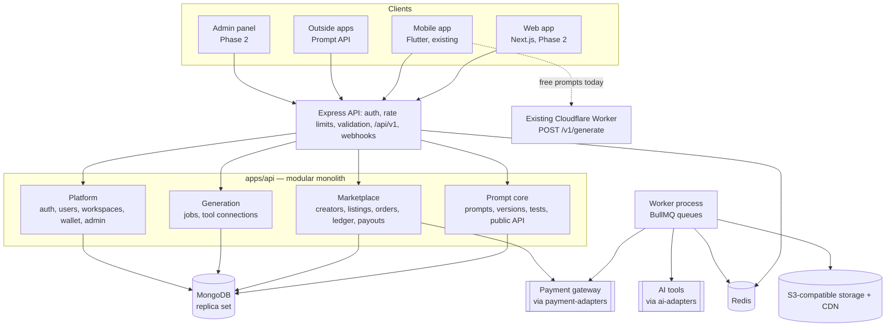

# Design

Full detail: [02-phase1-backend-plan.md](02-phase1-backend-plan.md). Decisions and their reasons: [DECISIONS.md](DECISIONS.md).

## Architecture overview

One backend, built first, serves every client. The web app, mobile app, admin panel and outside developers all use the same versioned REST API (`/api/v1`). AI tools, payment gateways and social platforms sit behind adapters, so adding or swapping one does not touch the rest of the system.



The API and the worker are two processes from one codebase and one Docker image. Anything slow or external (AI generation, media resizing, webhook processing, payouts, email and push) runs in the worker, never in the request.

## Components

| Component | Responsibility | Technology |
|-----------|----------------|------------|
| `apps/api` (server) | HTTP API under `/api/v1`, auth, validation, OpenAPI docs | Node.js 24, TypeScript strict, Express 5, Zod, `zod-to-openapi` |
| `apps/api` (worker) | Background jobs: generation, media, payments, payouts, notifications, maintenance | BullMQ on Redis |
| Feature modules (`apps/api/src/modules/*`) | Each owns its collections and endpoints; other modules call only its service | Mongoose models, Zod schemas, service, controller, routes |
| `packages/shared-types` | Zod schemas and inferred types shared with web and mobile | Zod, TypeScript |
| `packages/ai-adapters` | One adapter per AI provider behind `AiAdapter` | TypeScript |
| `packages/payment-adapters` | One adapter per payment gateway (`createCheckout`, `verifyWebhook`, `refund`, `createPayout`); fake provider first | TypeScript |
| MongoDB | System of record; transactions for money flows | MongoDB 7+ replica set (Atlas in staging/prod) |
| Redis | Queues, rate limits, cache | Redis + BullMQ, `rate-limiter-flexible` |
| Object storage | Sample outputs and generated media, signed upload URLs | S3-compatible (MinIO locally), CDN |
| Existing mobile backend | Free daily prompts for the mobile app (`POST /v1/generate`) | Cloudflare Worker + D1 (separate repo; see [HISTORY.md](HISTORY.md) audit) |

Module shape (every module):

```
modules/<name>/
  <name>.model.ts        Mongoose schema + indexes
  <name>.schemas.ts      Zod request/response schemas (also feed OpenAPI)
  <name>.service.ts      Business logic; the only thing other modules import
  <name>.controller.ts   Thin HTTP handlers
  <name>.routes.ts       Router with guards and validation
  <name>.jobs.ts         Queue producers/consumers (if any)
  __tests__/
```

## Data model

MongoDB, 20 collections. Embed what is small, bounded and always read with its parent; reference anything that grows without limit or is queried on its own. Full table with fields and indexes: [02-phase1-backend-plan.md § Data model](02-phase1-backend-plan.md#data-model-mongodb).

| Module | Collections |
|--------|-------------|
| Platform | users, workspaces, wallets / creditTransactions, notifications, auditLogs |
| Auth | refreshTokens |
| Core | prompts, promptVersions, testSets / testRuns |
| AI | generations, toolConnections |
| Marketplace | creatorProfiles, listings, listingMedia, bundles, orders, entitlements, reviews / reports, ledgerEntries, payouts |

Schema rules:

- `promptVersions` are immutable. Edits create a new version; rollback moves `latestVersionId`.
- Prompt `body` lives only in `promptVersions`. Listings reference the version and never copy its text.
- Money fields end in `Minor` (integer, smallest unit) with a `currency` code beside them.
- Creator balances are the sum of their ledger account, never a stored number edited by code.

## API / interfaces

All under `/api/v1`. Errors: `{ error: { code, message, details } }`. Lists: cursor pagination. Money-costing writes require `Idempotency-Key`.

| Method | Endpoint / interface | Purpose | Auth required |
|--------|----------------------|---------|---------------|
| GET | `/health` | API, MongoDB and Redis status (Phase 1 setup) | No |
| GET | `/docs` | OpenAPI 3.1 contract + Swagger UI (Phase 1 setup) | No |
| POST | `/auth/register`, `/auth/login`, `/auth/refresh`, `/auth/logout`, `/auth/oauth/:provider` | Accounts and tokens | No (rate limited) |
| GET/PATCH | `/me`; `/workspaces`, `/workspaces/:id/members` | Profile, workspaces, members | User; workspace role |
| * | `/prompts`, `/prompts/:id/versions`, `/prompts/:id/diff`, `/prompts/:id/rollback` | Prompt library and versions | Owner or workspace role |
| * | `/test-sets`, `POST /test-sets/:id/run` | Test sets and runs | Owner or workspace role |
| POST | `/run/:promptId` | Public Prompt API | Workspace API key (rate limited) |
| GET | `/listings`, `/listings/:id`, `/creators/:handle`, `/search` | Marketplace browse (never returns prompt text) | No |
| * | `/creator/profile`, `/creator/listings`, `/creator/bundles`, `/creator/stats` | Creator tools | Creator role |
| POST/GET | `/checkout`, `/orders`, `/entitlements` | Buying | Buyer |
| POST | `/webhooks/payments/:gateway` | Gateway callbacks | Webhook signature |
| GET/POST | `/creator/balance`, `/creator/payouts` | Payouts | Creator role |
| * | `/listings/:id/reviews`, `POST /reports` | Reviews and reports | Verified buyer for reviews |
| GET/POST | `/wallet`, `/wallet/top-up` | Credits | User |
| * | `/generations`, `/generations/:id`, `/tool-connections` | AI generation | User (rate limited) |
| * | `/admin/users`, `/admin/listings/:id/approve`, `/admin/payouts`, `/admin/reports` | Moderation and operations | Admin role |
| POST | `/v1/generate` (existing Cloudflare Worker, not `/api/v1`) | Mobile app free prompts | Install ID header |

## Key decisions and tradeoffs

Full log with dates: [DECISIONS.md](DECISIONS.md).

| Decision | Options considered | Chosen | Why | Tradeoff accepted |
|----------|--------------------|--------|-----|-------------------|
| Backend framework | NestJS, Express | Express 5 + imposed module structure | Plan assumed it matches the mobile backend; native async errors | We enforce module boundaries by convention and review, not by framework |
| Database | PostgreSQL + Prisma, MongoDB | MongoDB replica set + Mongoose | Plan assumed it matches the mobile backend | Ledger correctness depends on transactions and reconciliation, not foreign keys |
| Architecture | Microservices, modular monolith | Modular monolith (API + worker) | One deploy, simple ops for a small team | Modules must not read each other's collections |
| Validation and docs | Hand-written OpenAPI, Zod-generated | Zod → OpenAPI 3.1 | One schema for validation and contract | Tied to `zod-to-openapi` |
| Payments | Stripe, local gateways | Adapter + fake provider now; gateway later | Stripe does not onboard Pakistan businesses; don't block on the choice | Real gateway integration lands in sprint 4 |
| Prompt protection | Copy text into listing, reference version | Reference version; projections exclude `body` | Listing queries cannot leak text | Extra lookup when an entitled buyer reads a prompt |

## AI components

- **AI generation (product feature):** prompts run in external AI tools through `packages/ai-adapters`. Each adapter implements `formatPrompt`, `start`, `poll` and `estimateCost`. Jobs run in the worker with 3 retries and exponential backoff.
- **What code validates:** request input (Zod), credit balance before starting (`estimateCost`, minor units), provider output type and size before storing, job status transitions.
- **When AI fails:** the job is marked failed after retries, credits charged for it are refunded through a credit transaction, and the client sees the failure via polling or server-sent events. Tools with no public API use copy-out mode (`formatPrompt` only).
- **Existing mobile free prompts:** the Cloudflare Worker builds a meta-prompt and asks a pool of providers (Groq → Workers AI), falling through on failure and returning `503 pool_unavailable` when all fail.

## Security and privacy

### Threat model

| Threat | Control |
|--------|---------|
| Prompt text leaked through public endpoints or page source | Body only in `promptVersions`; explicit projections; CI test scans public responses |
| Leaked purchased prompt shared elsewhere | Hidden buyer marker tied to the entitlement; report flow |
| Cross-workspace data access | `authorize(role, resourceLoader)` on every route; services always filter by `workspaceId` (fails closed) |
| NoSQL injection | Zod on every input; strip `$` and `.` keys; never pass `req.body` to a query |
| Credential stuffing, abuse of paid endpoints | Redis rate limits on login, checkout, generation, Prompt API |
| Forged or replayed payment webhooks | Signature verification; idempotent by `gatewayRef` |
| Double charge or double grant | `Idempotency-Key`; unique indexes on `idempotencyKey`, `gatewayRef`, `buyerId + listingId` |
| Stolen third-party keys or tokens | AES-256-GCM at rest; `select: false`; never returned after saving |
| Secrets in the repo | Env only; `.env` git-ignored; `.env.example` placeholders only |

### Data handled

Email, name, avatar, locale; hashed refresh tokens; encrypted third-party API keys and payout details; orders and ledger entries (no card data — hosted checkout only); prompt text and generated media; audit logs of admin and money actions.

### Known limits

- Payment gateway not chosen yet; checkout runs against a fake adapter.
- Watermarking of buyer copies deters but does not prevent copying.
- The mobile app's free-prompt Worker is a separate service with its own data (daily hashed counters in D1) until it is folded into the shared backend.
